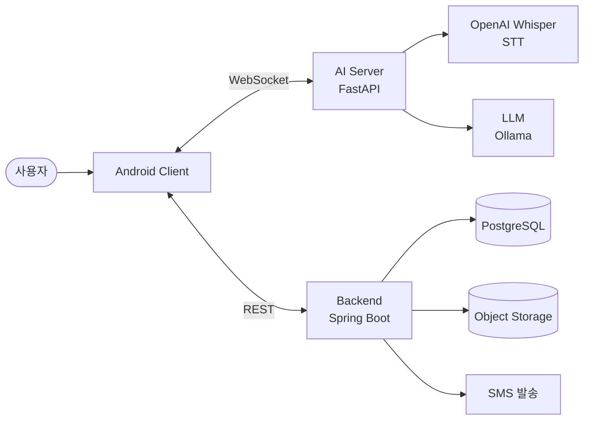

# Aven

> 안드로이드 AccessibilityService API와 LLM 기반 Intent Parsing 서버를 연동한 **Human-In-The-Loop(HITL) AI 스마트폰 보조 서비스**

| 무엇을 | 어떻게 | 안전장치 |
| --- | --- | --- |
| 공식 API가 없는 배달·예약·쇼핑 앱의 화면 조작을 대신합니다 | 접근성 API로 화면 구조를 읽고, AI 서버가 화면마다 다음 동작 1개를 정합니다 | 사용자가 **[실행]** 을 눌러야 시작하고, 결제 직전에는 반드시 멈춥니다 |

**📌 다음 할 일은 [PLAN.md](docs/plan/PLAN.md)에서 시작하세요.**

## 📑 목차

1. [프로젝트 개요](#-1-프로젝트-개요-overview)
2. [핵심 보안 및 정책 준수 원칙](#️-2-핵심-보안-및-정책-준수-원칙-compliance--security-rules)
3. [시스템 아키텍처](#️-3-시스템-아키텍처-system-architecture)
4. [데이터베이스 구조](#-4-데이터베이스-구조-database-schema)
5. [법적 및 규제 검토 진행 현황](#-5-법적-및-규제-검토-진행-현황-regulatory-status)
6. [샘플 개발 로드맵](#-6-샘플-개발-로드맵-sample-program-milestone)
7. [개발 환경 실행](#-7-개발-환경-실행-getting-started)

## 📚 문서 목록

| 분류 | 문서 | 설명 |
| --- | --- | --- |
| 🗺️ **계획** | [개발 계획 · 다음 할 일](docs/plan/PLAN.md) | 현재 상태, 문제점, 단계별 할 일, 결정 대기 |
| 🛡️ **규칙·규제** | [접근성 서비스 API 사용 정책](docs/policy/ACCESSIBILITY_POLICY.md) | AccessibilityService API 사용 목적 및 4대 준수 원칙 |
| 🛡️ **규칙·규제** | [개인정보 처리방침](docs/policy/PRIVACY_POLICY.md) | 개인정보 수집·이용·보관·파기 안내 (앱에 포함됨) |
| 🛡️ **규칙·규제** | [서비스 이용약관](docs/policy/TERMS_OF_SERVICE.md) | 이용조건, 권리·의무, 책임의 한계 |
| 🛡️ **규칙·규제** | [제3자 서비스 상호작용 방침](docs/policy/THIRD_PARTY_POLICY.md) | 제3자 앱 UI 접근 범위 및 제한 |
| 🛡️ **규칙·규제** | [보안 및 데이터 감사 정책](docs/policy/SECURITY_AUDIT.md) | RLS, Soft Delete, 감사 로깅 등 보호 조치 |
| 🛡️ **규칙·규제** | [정부 규제 대응 및 법률 부합성 보고서](docs/policy/REGULATORY_COMPLIANCE.md) | 정보통신망법·형법·개인정보보호법 검토 |
| 🛠️ **기술 명세** | [기술 스택 및 개발 환경 명세](docs/tech/TECH_STACK.md) | 레이어별 기술 스택, 개발/배포 환경, 데이터 흐름 |
| 🛠️ **기술 명세** | [WebSocket 프로토콜 명세](docs/tech/WEBSOCKET_PROTOCOL.md) | Android ↔ AI 서버 메시지 형식 (단계별 실행 포함) |
| ▶️ **실행** | [실행 방법](docs/guide/START.md) | 서버·에뮬레이터·실기기 실행, 앱 첫 사용, 문제 해결 |
| ▶️ **실행** | [폰 확인 체크리스트](docs/guide/DEVICE_CHECK.md) | 폰 없이 만든 기능을 실제 폰에서 한 번에 확인 |
| 📦 **모듈별** | [백엔드 API](backend/README.md) | 회원·계정·작업 기록·저장 공간 REST API |
| 📦 **모듈별** | [AI 서버](ai-server/README.md) | AI 서버 구성과 실행 방법 |
| 📦 **모듈별** | [Android](android/README.md) | Aven 앱·더미 배달 앱 빌드와 동작 구조 |

---

## 📌 1. 프로젝트 개요 (Overview)

본 프로젝트는 안드로이드 **AccessibilityService API**와 **LLM 기반 Intent Parsing 서버**를 연동하여, 배달·예약·쇼핑 등 공식 API가 제공되지 않는 제3자 모바일 앱의 화면 탐색 및 작업 입력을 대리 수행하는 AI 스마트폰 보조 서비스입니다.

스파이웨어 및 자율 매크로 오용을 방지하기 위해 **Human-In-The-Loop (HITL) 보안 아키텍처**를 적용하였으며, 구글 플레이 정책 및 정보통신망법·개인정보보호법 가이드라인을 철저히 준수합니다.

## 🛡️ 2. 핵심 보안 및 정책 준수 원칙 (Compliance & Security Rules)

| 원칙 | 내용 |
| --- | --- |
| **① 백그라운드 자율 제어 전면 금지** No Autonomous Background Actions | • 앱이 자율적으로 판단하여 백그라운드에서 실행되는 것을 전면 차단합니다. • 오직 사용자가 직접 음성/텍스트 명령을 입력한 시점에만 **1회성으로** 활성화됩니다. |
| **② HITL 최종 승인 체계** Human-In-The-Loop | • AI는 화면 제어 전, 명령(목표)·대상 앱·멈추는 조건을 **'승인 UI 카드'** 로 제시합니다. • 사용자가 **[실행/승인]** 버튼을 직접 터치한 시점에만 대리 조작이 시작되며, 승인한 목표 안에서만 화면을 한 단계씩 확인하며 진행합니다 (지점·옵션 등 선택은 사용자에게 질문). • 금융, 계정 설정 변경, 직접 결제 등 **민감 동작은 대리 실행 대상에서 전면 제외**됩니다. |
| **③ 실시간 시각적 피드백** Visual Overlay | • 화면 제어 시 터치 포인터 및 반투명 하이라이트 박스를 실시간 표시하여 사용자가 제어 과정을 완벽히 인지하도록 합니다. |
| **④ 전면 공개 및 명시적 동의** Prominent Disclosure | • 최초 실행 시 접근성 권한 사용 목적과 수집하지 않는 정보를 명시하는 전면 공개 안내창을 제공합니다. • 사용자가 안드로이드 시스템 설정에서 **직접** 권한을 부여하도록 설계합니다. |

> 자세한 내용은 [접근성 서비스 API 사용 정책](docs/policy/ACCESSIBILITY_POLICY.md)을 참고하세요.

## 🏗️ 3. 시스템 아키텍처 (System Architecture)

| 구분 | 기술 스택 | 주요 역할 |
| --- | --- | --- |
| **Android Client** | Kotlin, AccessibilityService, WindowManager Overlay, Coroutines & Flow | 전면 공개, 승인 카드, 대리 클릭, Visual Overlay, 민감 화면 차단 |
| **AI Server** | Python FastAPI (WebSocket), Ollama(개발) / 커스텀 튜닝 LLM(운영) | 대화 답변, 단계별 다음 동작 결정(레시피 우선), UI 구조 즉시 폐기 |
| **Backend** | Kotlin + Spring Boot (JPA) | 회원·SMS 인증, 작업 기록, 초기화·비활성화·탈퇴(익명화), 저장 공간 관리 |
| **Database** | PostgreSQL | JSONB, RLS, Soft Delete, Audit Trigger, 휴대폰 번호 암호화 |
| **Storage** | 오브젝트 스토리지 (개발: SeaweedFS / 운영: 클라우드) | 음성 녹음(1인 500MB), 대화 목록, 작업 오류 기록 |
| **External API** | OpenAI Whisper(STT), SMS 발송 대행 | 음성 인식, 가입 인증번호 발송 (응답 음성은 기기 내장 TTS) |

> 자세한 내용은 [기술 스택 및 개발 환경 명세](docs/tech/TECH_STACK.md)를 참고하세요.

## 📂 4. 데이터베이스 구조 (Database Schema)

| 항목 | 설명 |
| --- | --- |
| **JSONB Metadata** | 확장성을 고려한 작업 명령 및 Intent 스키마 저장 |
| **Row Level Security (RLS)** | 사용자 데이터 격리 및 접근 제어 |
| **Soft Delete (`is_deleted`)** | 데이터 삭제 시 물리 삭제 대신 논리 삭제 적용 |
| **Automated Audit Trigger** | 보안 모니터링 및 감사 로그 자동 기록 (`updated_at` 및 감사 트레이스) |
| **휴대폰 번호 암호화** | AES-256-GCM 암호화 + HMAC 블라인드 인덱스(중복 가입 확인용) |
| **탈퇴 시 익명화** | 계정 정보·음성 녹음 삭제, 텍스트 기록은 `user_id`를 익명 값으로 교체 |
| **재가입 제한 해시** | 탈퇴한 번호의 HMAC 해시를 30일간 별도 보관 |

> 자세한 내용은 [보안 및 데이터 감사 정책](docs/policy/SECURITY_AUDIT.md), [개인정보 처리방침](docs/policy/PRIVACY_POLICY.md)을 참고하세요.

## 📋 5. 법적 및 규제 검토 진행 현황 (Regulatory Status)

| 기관 | 상태 | 내용 |
| --- | :---: | --- |
| **Google Play Developer Support** | ✅ 제출 | 사전 알림(Advance Notice) 및 Accessibility API 정책 검토 요청 |
| **과학기술정보통신부** (ICT 규제샌드박스) | ✅ 통과 | 제3자 앱 UI 대리 제어 — 2026-10-26 통과 확인, 승인 범위·부가 조건은 결정서 확인 중 |
| **개인정보보호위원회** | ⏳ 예정 | 화면 UI 읽기 및 입력 대리 수행 과정의 개인정보보호법 유권해석 문의 |

> 자세한 내용은 [정부 규제 대응 및 법률 부합성 보고서](docs/policy/REGULATORY_COMPLIANCE.md)를 참고하세요.

## 🚀 6. 샘플 개발 로드맵 (Sample Program Milestone)

전체 기능을 샘플로 구현합니다. 이후 계획은 [PLAN.md](docs/plan/PLAN.md)에서 관리합니다.

| 단계 | 내용 | 상태 |
| --- | --- | :---: |
| **Phase 0** 개발 환경 | 저장소 구조(`android/` · `ai-server/` · `backend/` · `infra/`), Docker Compose로 PostgreSQL · SeaweedFS 실행, USB `adb reverse` 연결, 키는 환경 변수로 관리 (`.env`는 Git 제외) | ✅ |
| **Phase 1** 더미 앱 | 메뉴 → 장바구니 → 주문 확인 → 결제 화면 배달 앱 모사, 화면 전환 지연 · 팝업 · 광고 · 잘못된 금액 · 비밀번호 화면 상황 설정 | ✅ |
| **Phase 2** 접근성 & HITL | 전면 공개 화면, 명령 → 승인 카드, 대리 클릭 & Visual Overlay, 결제 · 비밀번호 · 금융 화면 차단, 긴급 중단, 클릭 간격 100~500ms | ✅ |
| **Phase 3** AI 서버 & WebSocket | JSON 프로토콜 정의 ([명세](docs/tech/WEBSOCKET_PROTOCOL.md)), 화면마다 다음 동작 1개 결정(레시피 우선) 후 UI 구조 즉시 폐기, Whisper STT, 기기 내장 TTS, 앱에서 민감 동작 한 번 더 차단 | ✅ |
| **Phase 4** 백엔드 & DB | JPA Entity · Repository, RLS · Soft Delete · Audit Trigger, 작업 기록(JSONB) 저장 및 민감정보 미저장 확인 | ✅ |
| **Phase 5** 회원 관리 | 휴대폰 SMS 인증 가입, 1인 1계정(암호화 + 블라인드 인덱스), 초기화 · 비활성화 · 탈퇴(익명화), 탈퇴 후 30일 재가입 제한 | ✅ |
| **Phase 6** 개인 저장 공간 | 음성 녹음 · 대화 목록 · 작업 오류 기록, 1인 500MB 제한 · 90% 알림 · 초과 시 오래된 녹음 삭제, 서명된 URL로만 제공 | ✅ |
| **Phase 7** 실기기 통합 확인 | 전체 흐름(가입 → 명령 → 승인 → 대리 클릭 → 기록 저장)을 실기기에서 확인 | ⏳ |

---

## 🧰 7. 개발 환경 실행 (Getting Started)

**필요 도구**: Docker Desktop, Python 3.12, JDK 17, Android Studio
