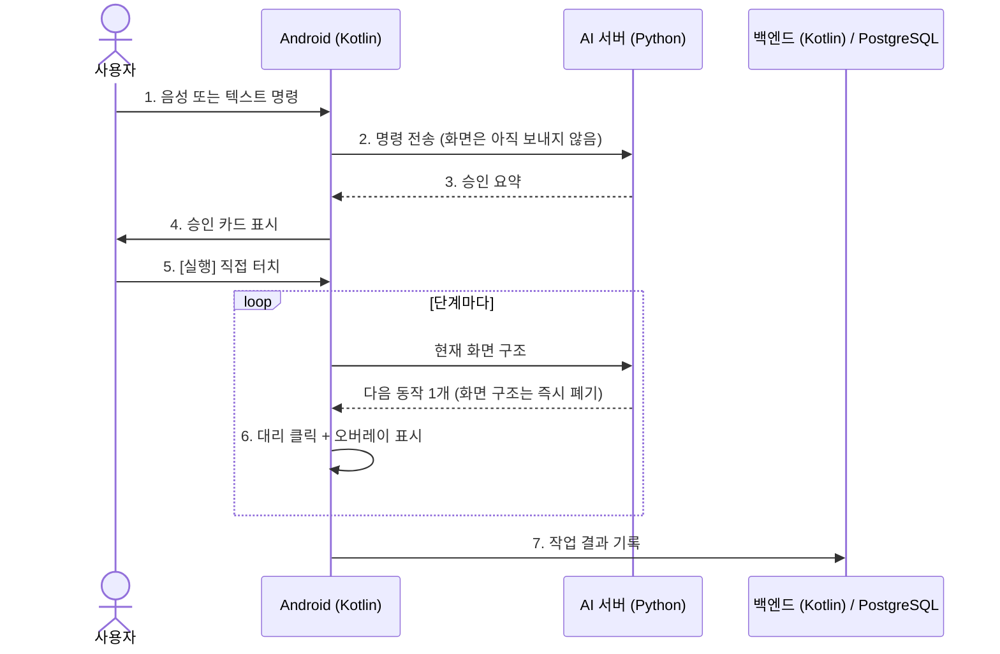

# 🛠️ 기술 스택 및 개발 환경 명세

> **Aven**의 레이어별 기술 스택, 개발 · 배포 환경, 데이터 흐름을 정리합니다.
> 안드로이드 앱과 백엔드를 **Kotlin**으로 만든 이유는 [3장](#-3-왜-kotlin인가-why-kotlin)에 따로 정리했습니다.

[← 문서 목록으로](../../README.md)

---

## 📑 목차

1. [한눈에 보기](#-1-한눈에-보기-at-a-glance)
2. [레이어별 기술 스택](#️-2-레이어별-기술-스택-tech-stack)
3. [왜 Kotlin인가](#-3-왜-kotlin인가-why-kotlin)
4. [개발 및 배포 환경](#-4-개발-및-배포-환경-devops--tools)
5. [시스템 데이터 흐름](#-5-시스템-데이터-흐름-system-data-flow)

---

## 📌 1. 한눈에 보기 (At a Glance)

| 레이어 | 언어 | 핵심 기술 |
| --- | --- | --- |
| 📱 Android 앱 | **Kotlin** | AccessibilityService, WindowManager Overlay, Coroutines & Flow |
| 🧠 AI 서버 | **Python** | FastAPI (WebSocket), Ollama, OpenAI Whisper |
| 🗄️ 백엔드 | **Kotlin** | Spring Boot (JPA) |
| 💾 데이터 | SQL | PostgreSQL, S3 호환 오브젝트 스토리지 |

| 항목 | 내용 |
| --- | --- |
| **개발 방법론** | 애자일 — 스프린트 단위 반복 개발 |
| **배포 대상** | Android 사용자 (Google Play 빌드 `play` · 갤럭시 스토어 빌드 `galaxy`) |

---

## 🏗️ 2. 레이어별 기술 스택 (Tech Stack)

### ① 안드로이드 클라이언트

| 구분 | 기술 | 하는 일 |
| --- | --- | --- |
| 개발 언어 | **Kotlin** | 앱 전체 ([3장](#-3-왜-kotlin인가-why-kotlin)) |
| 핵심 API | **AccessibilityService** | 화면 UI 노드 탐색, 대리 클릭 · 입력 · 스크롤 |
| 시각적 피드백 | **WindowManager Overlay** | 터치 포인터 · 반투명 하이라이트 박스 · 승인 카드 표시 |
| 네트워크 | **Ktor Client** 또는 **Retrofit2 + OkHttp** | AI 서버(WebSocket) · 백엔드(REST) 통신 |
| 비동기 처리 | **Coroutines & Flow** | 서버 응답 대기, 화면 변화 대기, 시간 제한 |
| 음성 합성 | **기기 내장 TTS** (`TextToSpeech`) | 승인 요청 · 질문 · 결과 읽어 주기 (외부 전송 없음) |

### ② AI 서버

| 구분 | 기술 | 하는 일 |
| --- | --- | --- |
| 개발 언어 | **Python** | |
| 웹 프레임워크 | **FastAPI** | 비동기 WebSocket, 외부 AI API 연동 |
| 음성 인식 (STT) | **OpenAI Whisper API** | 음성 명령을 텍스트로 변환 |
| 다음 동작 결정 | **레시피** (사람이 작성한 앱별 규칙) | 기본 방식 — 같은 화면이면 항상 같은 동작 |
| LLM | **Ollama** (개발) → 튜닝 모델 (운영) | 대화 답변, galaxy 빌드에서 레시피가 없는 앱의 다음 동작 |

### ③ 백엔드 & 데이터베이스

| 구분 | 기술 | 하는 일 |
| --- | --- | --- |
| 프레임워크 | **Kotlin + Spring Boot** (JPA) | 회원 · SMS 인증, 작업 기록, 계정 관리, 저장 공간 |
| 데이터베이스 | **PostgreSQL** | 아래 표 참고 |
| 개인 저장 공간 | S3 호환 오브젝트 스토리지 | 음성 녹음(1인 500MB), 대화 목록, 작업 오류 기록 |
| SMS 인증 | SMS 발송 대행 API | 업체 선정 예정 (개발 중에는 콘솔 출력) |

**PostgreSQL 주요 기능**

| 기능 | 용도 |
| --- | --- |
| `JSONB` | Intent 메타데이터, 유연한 작업 명령 스키마 |
| Row Level Security (RLS) | 사용자 간 데이터를 DB에서 격리 |
| Soft Delete | `is_deleted` 기반 논리 삭제 → 30일 뒤 물리 삭제 |
| Audit Trigger | 데이터 변경 감사 로그 자동 기록 |

---

## 🟣 3. 왜 Kotlin인가 (Why Kotlin)

### 한 줄 요약

> 안드로이드의 **공식 우선 언어**이고, 접근성 서비스처럼 OS 깊숙한 기능을 **네이티브로 직접** 다루면서도 **null 안전성**과 **코루틴** 덕분에 짧고 안전한 코드를 쓸 수 있기 때문입니다.

### ① 안드로이드 공식 우선 언어 (Kotlin-first)

- Google은 2019년부터 안드로이드 개발을 **Kotlin 우선**으로 진행하고 있습니다.
- 새 Jetpack 라이브러리, 공식 문서, 샘플 코드가 Kotlin 기준으로 먼저 나옵니다.
- 문제가 생겼을 때 찾을 수 있는 자료와 예제도 Kotlin이 가장 많습니다.

### ② 접근성 서비스는 네이티브로만 제대로 만들 수 있다

Aven의 핵심인 `AccessibilityService`, `WindowManager` 오버레이, 실제 터치 판정은 **안드로이드 OS API**입니다.

| 방식 | 접근성 서비스 구현 |
| --- | --- |
| **Kotlin (네이티브)** | OS API를 그대로 호출. 중간 계층 없음 |
| Flutter · React Native | 결국 이 부분은 네이티브 코드로 따로 작성해야 하고, 브리지를 거쳐 느려짐 |

화면을 단계마다 읽고 바로 누르는 앱이라, 중간 계층이 없는 네이티브가 속도와 안정성 모두 유리합니다.

### ③ Null 안전성 — 화면 요소는 "없을 수도" 있다

접근성 API가 돌려주는 화면 요소(`AccessibilityNodeInfo`)는 화면이 바뀌면 언제든 **null**이 될 수 있습니다. Java에서는 이런 값을 놓치면 실행 중 앱이 죽습니다(`NullPointerException`).
Kotlin은 **null이 될 수 있는 값을 타입으로 구분**해서, 처리하지 않으면 **컴파일 단계에서 막아 줍니다**.

```kotlin
// 예시 — 버튼을 찾지 못하면(null) 누르지 않고 멈춘다
val button: AccessibilityNodeInfo? = root.findByText("김밥")
button?.performAction(ACTION_CLICK) ?: stop("버튼을 찾지 못했습니다")
```

"확인하지 않은 버튼은 누르지 않는다"는 Aven의 원칙을 언어 차원에서 지키기 쉽습니다.

### ④ 코루틴 — 기다리는 일이 많은 앱

Aven은 **서버 응답 기다리기 → 화면이 바뀔 때까지 기다리기 → 5초 안에 안 나오면 중단**을 계속 반복합니다.
코루틴을 쓰면 이런 흐름을 콜백 없이 **위에서 아래로 읽히는 코드**로 쓸 수 있습니다.

```kotlin
// 예시 — 다음 동작을 받고, 대상 요소가 나타날 때까지 최대 5초 기다린다
val action = server.nextStep(screen)               // 네트워크 대기 (화면은 멈추지 않음)
val target = withTimeoutOrNull(5_000) { waitFor(action.target) }
    ?: return stop("화면에서 대상을 찾지 못했습니다")
```

### ⑤ 메시지 종류를 빠짐없이 처리 — `sealed class`

서버가 보내는 응답은 `next_action`, `ask`, `done`, `rejected`, `error` 중 하나입니다([WebSocket 명세](WEBSOCKET_PROTOCOL.md)).
`sealed class`로 묶으면 **한 가지라도 처리하지 않았을 때 컴파일 오류**가 나서, 예상하지 못한 응답으로 오동작할 일이 줄어듭니다.

```kotlin
// 예시
sealed class ServerMessage {
    data class NextAction(val step: Step) : ServerMessage()
    data class Ask(val question: String, val options: List<String>) : ServerMessage()
    data class Done(val message: String) : ServerMessage()
    data class Rejected(val reason: String) : ServerMessage()
}

when (msg) {                          // 하나라도 빠지면 컴파일 오류
    is ServerMessage.NextAction -> run(msg.step)
    is ServerMessage.Ask        -> showChoiceCard(msg)
    is ServerMessage.Done       -> showResult(msg.message)
    is ServerMessage.Rejected   -> stop(msg.reason)
}
```

### ⑥ 앱과 백엔드를 같은 언어로

- 백엔드도 **Kotlin + Spring Boot**로 만들어, 앱과 서버를 한 언어로 개발합니다.
- `data class`로 요청 · 응답 형식을 짧게 정의하고, 앱과 백엔드가 같은 문법으로 같은 데이터를 다룹니다.
- Java와 100% 호환되어 Spring, JPA 같은 Java 생태계 라이브러리를 그대로 씁니다.

### Java와 비교

| 항목 | Java | Kotlin |
| --- | --- | --- |
| null 처리 | 실행 중 오류(NPE)로 발견 | **컴파일 단계**에서 강제 |
| 비동기 | 콜백 · 스레드 직접 관리 | **코루틴** (순서대로 읽히는 코드) |
| 데이터 클래스 | getter · setter · equals 직접 작성 | `data class` 한 줄 |
| 응답 종류 분기 | 빠뜨려도 컴파일됨 | `sealed class` + `when`으로 누락 검사 |
| 안드로이드 지원 | 지원 | **공식 우선 언어** |

---

## 💻 4. 개발 및 배포 환경 (DevOps & Tools)

### ① 로컬 개발 환경

| 구분 | 기술 | 비고 |
| --- | --- | --- |
| 로컬 서버 | **Docker Compose** | PostgreSQL, S3 호환 저장소(SeaweedFS) |
| 기기 연결 | **USB `adb reverse`** | 에뮬레이터 · 실기기 ↔ 로컬 PC 서버 |
| LLM | **Ollama** | 로컬 GPU에서 한국어 모델 실행 |
| SMS | 콘솔 출력용 가짜 발송기 | 실제 SMS 비용 없이 인증 흐름 확인 |

### ② 운영 및 배포 환경

| 구분 | 기술 |
| --- | --- |
| 컨테이너 | **Docker & Docker Compose** |
| 클라우드 | **AWS / GCP / Oracle Cloud** 중 선택 (국내 리전) |

### ③ 프로젝트 관리

| 구분 | 기술 |
| --- | --- |
| 형상 관리 | **Git / GitHub** |
| 이슈 · 스프린트 | **GitHub Projects** 또는 **Jira** |

---

## 🔄 5. 시스템 데이터 흐름 (System Data Flow)



| 단계 | 주체 | 동작 |
| :---: | --- | --- |
| 1 | 👤 사용자 | 음성 또는 텍스트 명령 (예: *"A배달 앱에서 B메뉴 장바구니에 담아줘"*) |
| 2 | 📱 Android | 명령을 AI 서버로 WebSocket 전송. **화면 구조는 승인 뒤에만** 보냄 |
| 3 | 🧠 AI 서버 | 음성이면 Whisper로 텍스트 변환 → 목표 · 대상 앱 · 멈추는 조건 정리 |
| 4 | 📱 Android | 승인 카드 표시 |
| 5 | 👤 사용자 | **[실행]** 직접 터치 |
| 6 | 📱 ↔ 🧠 | 화면마다 다음 동작 1개를 받아 실행 (레시피 기본, 결제 직전 정지) |
| 7 | 🗄️ 백엔드 | 작업 결과를 JSONB와 감사 로그로 기록, 음성 · 대화는 개인 저장 공간에 |
