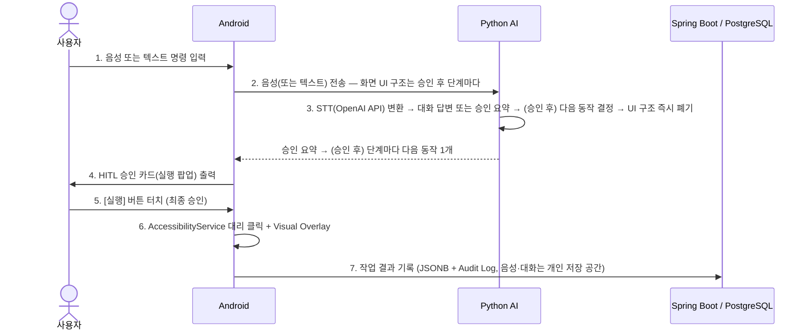

# 🛠️ Aven 기술 스택 및 개발 환경 명세

> 본 문서는 **Aven** 프로젝트의 시스템 아키텍처, 레이어별 기술 스택, 개발/배포 환경 및 데이터 흐름을 정의합니다.

## 📑 목차

1. [기본 개발 표준](#-1-기본-개발-표준-development-standards)
2. [레이어별 기술 스택](#️-2-레이어별-기술-스택-tech-stack)
3. [개발 및 배포 환경](#-3-개발-및-배포-환경-devops--tools)
4. [시스템 데이터 흐름](#-4-시스템-데이터-흐름-system-data-flow)

---

## 📌 1. 기본 개발 표준 (Development Standards)

| 항목 | 내용 |
| --- | --- |
| **개발 방법론** | 애자일(Agile) 방법론 — 스프린트 단위 반복 개발 |
| **배포 대상** | 안드로이드 사용자 — **빌드 둘**: `play`(Google Play, 레시피만) / `galaxy`(갤럭시 스토어, 허용 앱에서 AI 단계 실행). 출시 목표 2027-03-01 |
| **타깃 OS/기기** | Android OS (Kotlin 클라이언트 앱). 화면 판단·음성 인식은 **서버에서** 처리 (온디바이스 처리 아님) |

---

## 🏗️ 2. 레이어별 기술 스택 (Tech Stack)

### ① 안드로이드 클라이언트 (Android Client)

| 구분 | 기술 | 비고 |
| --- | --- | --- |
| 개발 언어 | **Kotlin** | |
| 핵심 API | **AccessibilityService** | 화면 UI 노드 탐색 및 대리 클릭 수행 |
| UI | **Android View** (Jetpack Compose 미사용 — 메모리·시작 속도) | 채팅 목록은 `ListView` 재사용 |
| 시각적 피드백 | **WindowManager Overlay** (`TYPE_ACCESSIBILITY_OVERLAY`) | 화면 상 터치 포인터 및 반투명 하이라이트 박스 실시간 표시, 승인 카드 |
| 네트워크 통신 | **OkHttp** (클라이언트 하나를 공유) | WebSocket(AI 서버, 연결 재사용) 및 REST API(백엔드) |
| 비동기 처리 | **Kotlin Coroutines** | |

### ② AI Engine & 음성 처리 (Python AI Server)

| 구분 | 기술 | 비고 |
| --- | --- | --- |
| 개발 언어 | **Python** | |
| 웹 프레임워크 | **FastAPI** | Async WebSocket 및 외부 AI API 연동 최적화 |
| STT (음성 인식) | **OpenAI Whisper API** | |
| 날씨 | 개발: **Open-Meteo**(키 없음, 비상업) → 출시: **기상청 단기예보 API** | 말 속 지역 이름 → 서버의 지역 표 좌표. GPS 안 씀, 사용자 정보 안 보냄. 숫자는 API 값으로 서버가 문장을 만듦(LLM 안 거침) |
| 다음 동작 결정 | **레시피**(앱별 고정 순서, JSON) 기본 + galaxy 빌드의 허용 앱만 LLM | 화면마다 다음 동작 1개 (계획 전체를 미리 만들지 않음) |
| LLM (대화 답변, galaxy 단계 판단) | 아래 표 참고 | |
| TTS (음성 합성) | 현재 **기기 내장 TTS** (Android `TextToSpeech`, 외부 전송 없음) | 2026-10-14 결정: **Typecast 기본**으로 변경 예정 (D6, 구현 시 처리방침 위탁 표 추가) |

**LLM 운영 방식**

| 단계 | 환경 | 모델 |
| --- | --- | --- |
| 🧪 개발 (로컬) | 원격 GPU PC (사설 VPN) | **Ollama** — `exaone3.5`(기본), `qwen2.5:7b` |
| 🚀 운영 (배포) | 클라우드 | OpenAI 호환 API (업체 미정, D4) → 이후 수집 데이터로 미세조정한 모델 |

### ③ 메인 백엔드 & 데이터베이스 (Backend & DB)

| 구분 | 기술 |
| --- | --- |
| 프레임워크 | **Kotlin + Spring Boot** (AI 서버 FastAPI와 분리 운영), 마이그레이션 **Flyway** |
| 데이터베이스 | **PostgreSQL** |
| 개인 저장 공간 | 오브젝트 스토리지 (S3 / GCS / OCI Object Storage 중 클라우드에 맞춰 선택) — 음성 녹음, 대화 목록, 작업 오류 기록, 음성 1인 500MB |
| SMS 인증 | SMS 발송 대행 API (업체 선정 예정) |

**PostgreSQL 주요 활용 기능**

| 기능 | 용도 |
| --- | --- |
| `JSONB` | 작업 기록의 단계 설명(`action_plan` 열), 작업 오류(`error`), 사용자 설정(`settings`) |
| Row Level Security (RLS) | 사용자 간 데이터를 DB 레이어에서 격리 |
| Soft Delete | `is_deleted` 기반 논리 삭제 적용 |
| Audit Trigger | 데이터 수정 및 접근 감사 로그 자동 기록 |

---

## 💻 3. 개발 및 배포 환경 (DevOps & Tools)

### ① 로컬 개발 환경 (내 컴퓨터 / 개발 단계)

| 구분 | 기술 | 비고 |
| --- | --- | --- |
| 로컬 서버 | **Python FastAPI** | STT / LLM / TTS 파이프라인 처리 |
| 기기 연결 | **USB `adb reverse`** (`android/connect-device.ps1`) | 에뮬레이터·실기기 ↔ 로컬 PC 서버 |
| 로컬 저장소 | **SeaweedFS** (Docker Compose) | S3 호환 오브젝트 스토리지, 개인 저장 공간 개발용 (MinIO는 Docker 이미지 배포 중단) |
| SMS | 콘솔 출력용 가짜 발송기 | 개발 중 실제 SMS 비용 없이 인증 흐름 확인 |

### ② 운영 및 배포 환경

| 구분 | 기술 |
| --- | --- |
| 컨테이너화 | **Docker & Docker Compose** |
| 클라우드 인프라 | **AWS / GCP / Oracle Cloud** 중 선택 |

### ③ 프로젝트 관리 도구

| 구분 | 기술 |
| --- | --- |
| 형상 관리 | **Git / GitHub** |
| 이슈 및 스프린트 관리 | **GitHub Projects** 또는 **Jira** |

---

## 🔄 4. 시스템 데이터 흐름 (System Data Flow)

| 단계 | 주체 | 동작 |
| :---: | --- | --- |
| 1 | 👤 **사용자** | 음성 또는 텍스트 명령 입력 (예: *"A배달 앱에서 B메뉴 장바구니에 담아줘"*) |
| 2 | 📱 **Android** | 음성(또는 텍스트)을 Python AI 서버로 WebSocket 전송. 화면 UI 구조는 사용자가 승인한 뒤 단계마다 보냄 |
| 3 | 🧠 **Python AI** | STT(OpenAI Whisper API)로 텍스트 변환 → 대화 답변 또는 승인 요약. 승인 후에는 단계마다 레시피(galaxy 빌드는 레시피 없는 앱에 LLM)로 다음 동작 결정 → UI 구조 즉시 폐기 |
| 4 | 📱 **Android** | 화면에 HITL 승인 카드(실행 팝업) 출력 |
| 5 | 👤 **사용자** | **[실행]** 버튼 직접 터치 (최종 승인) |
| 6 | 📱 **Android** | AccessibilityService가 Visual Overlay와 함께 단계마다 동작 1개 수행 (결제 직전·질문·이탈·터치 시 정지) |
| 7 | 🗄️ **Spring Boot / PostgreSQL** | 작업 결과를 JSONB 형태 및 Audit Log로 기록, 음성 녹음·대화는 개인 저장 공간에 보관 |
